# Japandi Capybara

[](https://github.com/Stukongeluk/japandi-capybara/releases/latest)
[](#install)
[](#notes)
[](https://github.com/Stukongeluk/japandi-capybara/commits/main)
[](https://github.com/Stukongeluk/japandi-capybara/stargazers)
[](LICENSE)

An animated, light Japandi theme for the Claude desktop app: a sunlit room with a round window, shoji screens, a swaying bonsai, drifting sakura petals, a meditating samurai and two very relaxed capybaras. The motion borrows from hand-drawn anime: held steam frames, petal smears, a head turn with anticipation and overshoot, a dragonfly that darts with speed lines.



*While Claude works: the samurai trains (harder as the CPU works harder), the scroll follows the task list, the sky turns toward sunset as the usage limit runs down, and the room shows CPU, RAM, GPU and context.*


*While Claude rests: the samurai meditates and the capybara dozes.*

The room also shows what is going on, without a single gauge:

| What | In the room |
| --- | --- |
| RAM | Shoji panes glow warm, filling from the bottom up |
| CPU | The samurai's incense: more smoke, rising faster; while Claude works he trains harder, with sweat and dust from 55% and speed lines above 80% |
| GPU load | Steam from the capybara's hinoki bath |
| GPU temperature | The bath heats up: bubbles, a red-faced capybara, and above 83° it climbs halfway out |
| Claude usage limit | Sakura blossoms on the branch fall onto the shelf as you use your 5-hour limit, and the sky in the round window turns from morning to sunset; a plaque shows 5h and 7d usage and when it resets |
| Context window | The paper lantern dims as the conversation fills up |
| What Claude is doing | A hanging scroll shows the current step, the task list and background work |
| Working or resting | The samurai practises sword cuts while Claude works and meditates when it rests; the capybara dozes off |
| Your own clock | A soft pink dawn, a golden evening, and at night a lantern-lit room with a moon and stars in the window (the moon sinks as you use your limit) |
| A click on the room | The left half: the samurai bows. The right half: the capybara squeaks and its yuzu hops |
| Sounds (with the speaker on) | A squeak or a soft wooden note on a click, a chime when Claude finishes a whole task list, and a gong on the first message after your 5-hour limit resets |

The sky through the round window follows your 5-hour limit, with a pagoda on the ridge and birds passing now and then:

| 10% used — morning | 55% used — afternoon | 92% used — sunset |
| :---: | :---: | :---: |
|  |  |  |

While Claude works, the samurai trains as hard as your CPU:

| Under 55% — calm cuts | 55–80% — heavy training | Over 80% — all out |
| :---: | :---: | :---: |
|  |  |  |

The bath follows your GPU temperature:

| 50° — a relaxed soak | 79° — a rolling boil | 88° — time to get out |
| :---: | :---: | :---: |
|  |  |  |

The images are drawn by the theme's own code with sample figures, and they move, as the room does.

It also restyles messages (washi cards with a small red seal) and adds a quiet ambience you can switch on with the speaker button in the session's title bar: a breeze, a wind chime and the bath trickling.

## In the terminal

The terminal draws no themes, so there the theme shows a band above the prompt instead: a small pixel-art capybara soaking in its tub (steaming with GPU load, blushing, boiling and climbing out as the GPU heats, dozing while Claude rests) beside three lines of the room's readings:

```
今 ▸ Add the login page (2/4) · Editing src/login.tsx
記憶 RAM 58%  香 CPU 12%  湯 GPU 30% 52°  残花 5h 42% 7d 18%  灯 ctx 35%
limit resets 14:30 · 裏 agent: Review the changes
```

## Install

At the prompt of a terminal session:

```
/plugin install japandi-capybara --marketplace Stukongeluk/japandi-capybara
```

From a shell:

```
claude plugin install japandi-capybara --marketplace Stukongeluk/japandi-capybara
```

In the desktop app, where `/plugin` does not run: click **+** next to the prompt box, then **Plugins**, **Add marketplace** with `Stukongeluk/japandi-capybara`, then **Add plugin**.

## Notes

- The room is drawn in the desktop and mobile apps. The terminal does not draw themes.
- CPU, RAM and GPU readings come from one small background process, chosen per system:
  - **Windows:** PowerShell; GPU from `nvidia-smi` on NVIDIA cards.
  - **Linux:** `/proc`; GPU from `nvidia-smi` on NVIDIA cards, or the driver's own files on AMD cards.
  - **macOS:** `top`, `vm_stat` and `ioreg`; GPU load on Apple Silicon. macOS reports no GPU temperature, so the bath stays relaxed there.

  Without a supported GPU the room still runs, without the GPU readings.
- The usage-limit plaque needs a Claude subscription and fills in after the first reply of a session.
- The layout is tuned for a wide window with the sidebar open. On a tall (portrait) screen, where the chat covers the middle of the room, a narrow paper strip hangs at the right edge with every reading written top to bottom.

## License

[MIT](LICENSE). `hooks/make-colors.js` and `hooks/make-colors.d.ts` are the color helper from Claude Code's theme kit, included unchanged; the MIT license covers the rest of this repository.
