# Japandi Capybara

An animated, light Japandi theme for the Claude desktop app: a sunlit room with a round window, shoji screens, a swaying bonsai, drifting sakura petals, a meditating samurai and two very relaxed capybaras. The motion borrows from hand-drawn anime: held steam frames, petal smears, a head turn with anticipation and overshoot, a dragonfly that darts with speed lines.


*While Claude works: the samurai trains, the scroll follows the task list, and the room shows CPU, RAM, GPU, usage limit and context.*



*While Claude rests: the samurai meditates and the capybara dozes.*

The room also shows what is going on, without a single gauge:

| What | In the room |
| --- | --- |
| RAM | Shoji panes glow warm, filling from the bottom up |
| CPU | The samurai's incense: more smoke, rising faster |
| GPU load | Steam from the capybara's hinoki bath |
| GPU temperature | The bath heats up: bubbles, a red-faced capybara, and above 83° it climbs halfway out |
| Claude usage limit | Sakura blossoms on the branch fall onto the shelf as you use your 5-hour limit; a plaque shows 5h and 7d usage and when it resets |
| Context window | The paper lantern dims as the conversation fills up |
| What Claude is doing | A hanging scroll shows the current step, the task list and background work |
| Working or resting | The samurai practises sword cuts while Claude works and meditates when it rests; the capybara dozes off |

The bath follows your GPU temperature:

| 50° — a relaxed soak | 79° — a rolling boil | 88° — time to get out |
| :---: | :---: | :---: |
|  |  |  |

The images are drawn by the theme's own code with sample figures, and they move, as the room does.

It also restyles messages (washi cards with a small red seal) and adds a quiet ambience you can switch on with the speaker button in the session's title bar: a breeze, a wind chime and the bath trickling.

## Install

At the prompt of a terminal session:

```
/plugin install japandi-capybara --marketplace Stukongeluk/japandi-capybara
```

From a shell:

```
claude plugin install japandi-capybara --marketplace Stukongeluk/japandi-capybara
```

In the desktop app, where `/plugin` does not run: click **+** next to the prompt box, then **Plugins**, **Add marketplace** with `Stukongeluk/japandi-capybara`, then **Add plugin**.

## Notes

- The room is drawn in the desktop and mobile apps. The terminal does not draw themes.
- CPU, RAM and GPU readings come from a background PowerShell process, so they work on Windows only; GPU readings need an NVIDIA card with `nvidia-smi`. Elsewhere the room still runs, without those readings.
- The usage-limit plaque needs a Claude subscription and fills in after the first reply of a session.
- The layout is tuned for a wide window with the sidebar open.
